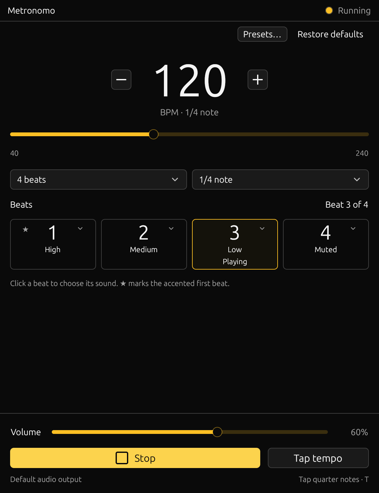
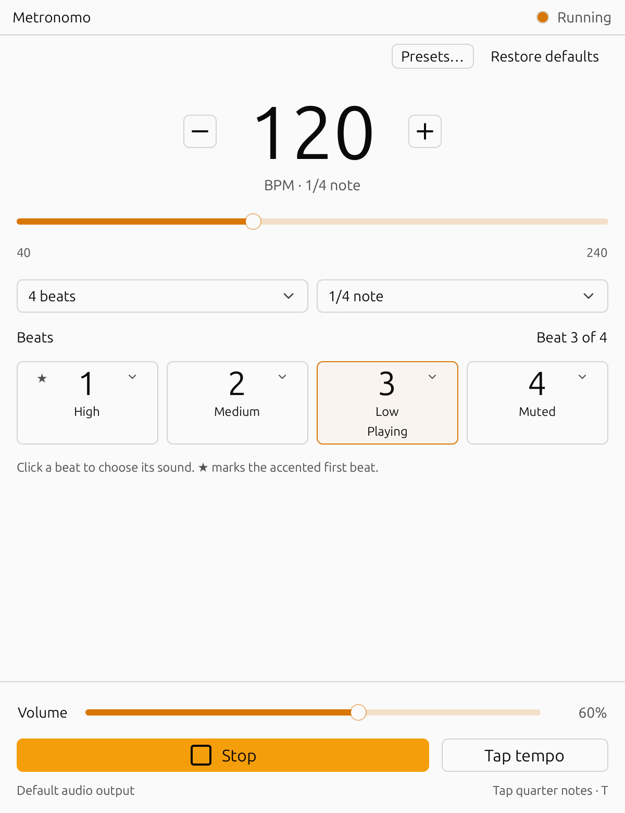
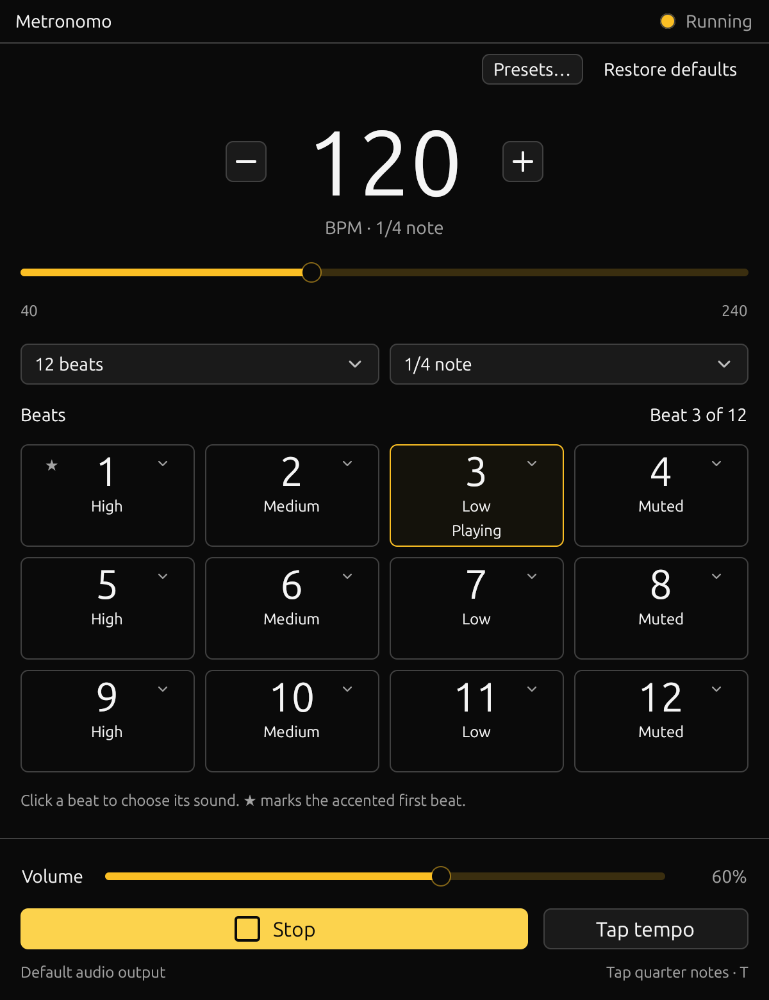
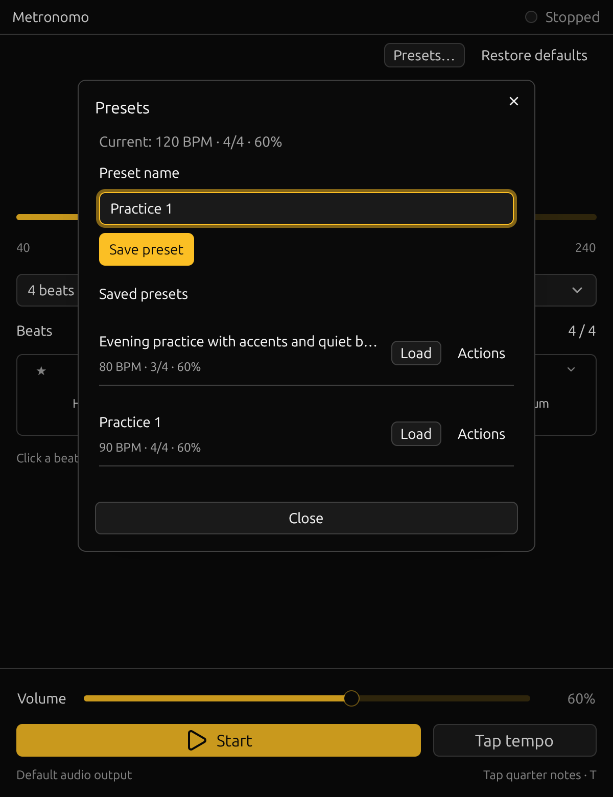

# Metronomo

A native desktop metronome for music practice, built with **Rust** and **GPUI Kit**.
Set your tempo, choose the sound of each beat, and save your favorite practice setups.

[Screenshots](#screenshots) · [Installation](#installation) · [Usage](#usage) · [Development](#development) · [Releases](https://github.com/zerossB/metronomo-rust/releases)

**Early development.** Linux packages target Ubuntu **24.04 and 26.04, amd64**.
The [validation report](docs/validation/report.md) tracks completed checks and
remaining desktop/audio acceptance work.

## Screenshots

| Dark theme | Light theme |
| :---: | :---: |
|  |  |

## Features

| Feature | What it does |
| --- | --- |
| **Tempo** | 40–240 BPM, with a slider, one-BPM adjustments, and Tap Tempo. |
| **Rhythm** | 1–12 beats per bar and half, quarter, eighth, or sixteenth-note units. |
| **Beat sounds** | Independent High, Medium, Low, or Muted sounds, with an accented first beat. |
| **Visual feedback** | A numbered beat grid, current-beat counter, and amber playback indicator. |
| **Practice presets** | Save, load, rename, delete, and undo deletion of named configurations. |
| **Everyday use** | Automatic settings persistence, keyboard controls, and light/dark themes. |

| Twelve-beat patterns | Saved presets |
| :---: | :---: |
|  |  |

Captures use the application's production views with example settings.
[Capture details and regeneration commands](docs/images/README.md).

## Installation

Tagged builds are distributed through [GitHub Releases](https://github.com/zerossB/metronomo-rust/releases).
When a release is available, download its `.deb` and `SHA256SUMS` into the same
directory, then run:

```sh
sha256sum --check --ignore-missing SHA256SUMS
sudo apt install ./metronomo_*_amd64.deb
metronomo
```

You can also launch **Metronomo** from the application menu. The installed
application needs a graphical X11 or Wayland session, a Vulkan-capable graphics
driver, and a working default audio output. Rust is only needed to build from source.

To uninstall:

```sh
sudo apt remove metronomo
```

Uninstalling preserves your saved settings and presets. Other Linux distributions,
ARM64, macOS, and Windows are currently outside the validated release scope.

## Usage

1. Set the BPM with the slider or **− / +** buttons.
2. Choose the number of beats and the note unit.
3. Click a numbered beat to choose its sound.
4. Press **Start** to begin; adjust tempo and volume while playing.
5. Use **Presets…** to save a setup, or **Restore defaults** to return to 120 BPM,
   60% volume, and 4/4.

**BPM always refers to quarter notes.** Tap quarter notes with **Tap tempo** or
**T**, regardless of the selected note unit. Muted beats keep their place in the
visual count, and volume at zero lets you practice with visual feedback alone.

| Shortcut | Action |
| --- | --- |
| `T` | Tap Tempo outside menus |
| `Space` / `Enter` | Start/stop when the main view or playback button is focused |
| `↑` / `↓` | Adjust tempo; adjust volume when the volume control is focused |
| `Tab` / `Shift+Tab` | Move between controls |
| `Escape` | Dismiss a menu or the presets dialog |
| `Ctrl+Q` / `Cmd+Q` | Quit and finish pending settings saves |

Tempo, volume, time signature, beat sounds, and presets save automatically.
Playback starts stopped when the application opens. See the
[usage guide](docs/usage.md) for all shortcuts, Tap Tempo behavior, preset
management, and settings locations.

## Development

Install Rust through `rustup` and the native dependencies listed in the
[development guide](docs/development.md#requirements). The Rust toolchain,
formatter, and Clippy are pinned in `rust-toolchain.toml`.

```sh
git clone https://github.com/zerossB/metronomo-rust.git
cd metronomo-rust
cargo run --locked
```

Build an optimized executable:

```sh
cargo build --release --locked
```

Run the development checks:

```sh
cargo fetch --locked
./scripts/check.sh
```

The check script covers formatting, compilation, Rust and Python tests, Clippy,
and desktop entry validation. The same checks run on every pull request.
Tests that open a real window or play audio are opt-in.

### Project layout

```text
.github/     # Pull request CI, tagged releases, and shared build setup
src/         # Application, metronome, audio, persistence, and themes
packaging/   # Linux desktop integration, Debian metadata, and licenses
scripts/     # Development checks, release automation, and validation
docs/        # Guides, screenshots, release notes, and validation reports
```

`target/` contains generated build output. `dist/` contains packages, release
bundles, and validation evidence. Both are ignored by Git.

Pushing a tag such as `v0.1.0` tests the application, builds the `.deb` on
Ubuntu 24.04, checks installation on Ubuntu 24.04 and 26.04, and publishes the
installer, release bundle, and checksums. Tag, Cargo, and Debian versions must
match. Follow the [release guide](docs/release.md#github-actions-and-version-tags)
to prepare a version.

## Documentation

- [Usage guide](docs/usage.md): controls, beat sounds, settings, and presets.
- [Development guide](docs/development.md): setup, tests, project structure, and state ownership.
- [Release guide](docs/release.md): packaging, version tags, and publication.
- [Validation report](docs/validation/report.md): measured results and remaining acceptance checks.
- [Changelog](CHANGELOG.md): changes by version.

## Roadmap

- [ ] Validate playback timing and responsiveness on supported platforms.
- [ ] Document installation and prepare the first release.

## Contributing

See [CONTRIBUTING.md](CONTRIBUTING.md) for the pull request process and
[SECURITY.md](SECURITY.md) to report a vulnerability privately.

Keep changes focused, run `./scripts/check.sh`, and update the relevant guide
when behavior changes. For audio or timing changes, include the platform and
conditions used to validate them.

## License

[MIT](LICENSE) © Guilherme Haynes Howe. Bundled dependencies and assets retain
their own licenses; Linux packages include their third-party notices.
